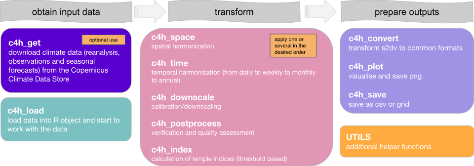
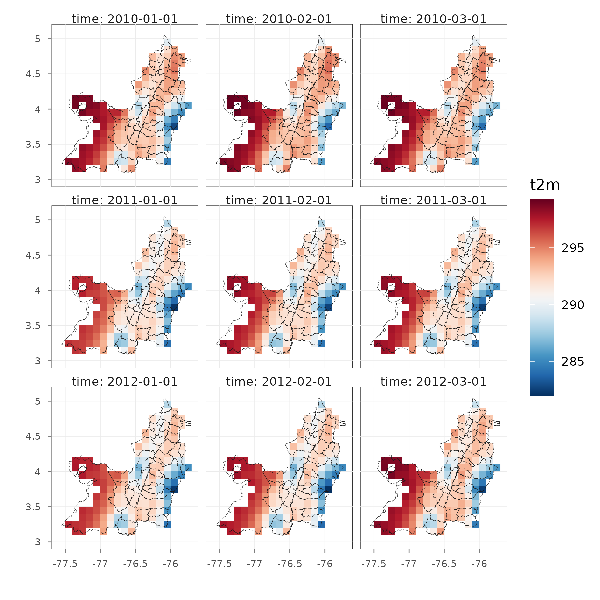

# clim4health   <span> <span>  

<!-- badges: start -->
[](https://www.gnu.org/licenses/agpl-3.0.html)

<!-- [](https://cran.r-project.org/package=clim4health) -->
<!-- [](https://cran.r-project.org/package=clim4health) -->
<!-- [](https://cran.r-project.org/package=clim4health) -->
<!-- badges: end -->


## Overview

**clim4health** is an R package designed to obtain, transform and export climate 
data for their use in epidemiological analyses and other types of applications. 
The package contains a series of functions structured in three sequential blocks: 
input, transformation, and output. 

In the input block, **clim4health** provides functions to download several types of 
climate data including reanalyses, seasonal forecasts and hindcasts, and weather 
stations and load them into memory for their processing. The transformation block
includes functions to postprocess and downscale climate data, perform spatiotemporal
aggregations, as well as compute threshold-based suitability indicators. Finally, 
in the output block, functions to visualize and export the transformed data are 
provided.

<br>
<div align="center">

</div>
<br> 

**clim4health** is one of the packages developed by the
[Global Health Resilience](https://www.bsc.es/discover-bsc/organisation/research-departments/global-health-resilience) (GHR)
team at the [Barcelona Supercomputing Center](https://www.bsc.es/) (BSC) within 
the [HARMONIZE](https://www.harmonize-tools.org/) project, which comprises 
different R and Python libraries tailored for health, climate, environmental, 
and socioeconomic data acquisition, harmonisation, and visualization.

More information about the R packages developped at GHR for climate and health workflows 
and an online version of the package documentation can be found at the
[GHR tools website](https://bsc-es.github.io/GHRtools/).


## Installation

```R
# Install from CRAN
install.packages("clim4health")

# Get the development version from Gitlab
devtools::install_git('https://earth.bsc.es/gitlab/ghr/clim4health.git')
```

## Usage

```R
# Load climate reanalysis temperature data included in the package
# and plot it for the study area
library("clim4health")
library("sf")

# Region municipalities
mun_path <- system.file("extdata", "areas", "munip_vallecauca.gpkg",
                        package = "clim4health")
mun <- read_sf(mun_path)

# Reanalysis data
rean_path <- system.file("extdata", "reanalysis", package = "clim4health")
rean <- c4h_load(rean_path, variable = "t2m", ext = 'nc')

# clim4health plot
c4h_plot(rean, 
         boundaries = mun,
         mask_boundaries = TRUE, 
         coordgrid = TRUE)
```

<div align="center">

</div>

## Developers

**[Emily Ball, PhD](https://www.bsc.es/ball-emily)**
<a href="https://orcid.org/0000-0002-3002-4068" style="margin-left: 15px;"></a>\
Barcelona Supercomputing Center\
Climate Services

**Alba Llabrés, PhD**
<a href="https://orcid.org/0000-0003-2144-675X" style="margin-left: 15px;"></a>\
Barcelona Supercomputing Center\
Climate Services

**[Carles Milà, PhD](https://www.bsc.es/mila-garcia-carles)**
<a href="https://orcid.org/0000-0003-0470-0760" style="margin-left: 15px;"></a>\
Barcelona Supercomputing Center\
Global Health Resilience

**Raul Capellan Fernandez, MSc** \
Barcelona Supercomputing Center\
Earth Data and Diagnostics

**[Rebeca Nunes, MSc](https://www.bsc.es/es/nunes-rodrigues-rebeca)** 
<a href="https://orcid.org/0009-0009-8738-0985" style="margin-left: 15px;"></a>\
Barcelona Supercomputing Center\
Earth Data and Diagnostics

**[Daniela Lührsen, MSc](https://www.bsc.es/luhrsen-daniela-sofie)**
<a href="https://orcid.org/0009-0002-6340-5964" style="margin-left: 15px;"></a>\
Barcelona Supercomputing Center\
Global Health Resilience

**[Anna B. Kawiecki, PhD](https://www.bsc.es/kawiecki-peralta-ania)**
<a href="https://orcid.org/0000-0002-0499-2612" style="margin-left: 15px;"></a>\
Barcelona Supercomputing Center\
Global Health Resilience

**[Rachel Lowe, PhD](https://www.bsc.es/lowe-rachel)**
<a href="https://orcid.org/0000-0003-3939-7343" style="margin-left: 15px;"></a>\
Barcelona Supercomputing Center\
Global Health Resilience (Group leader)
