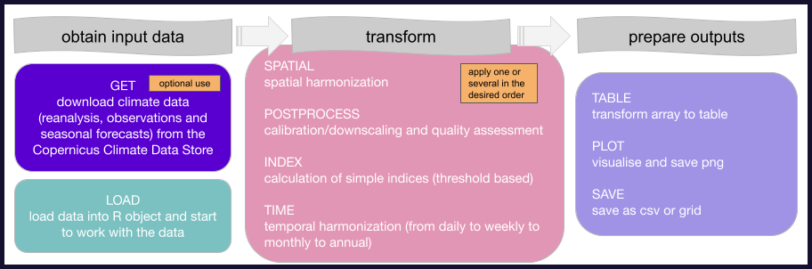

# Tutorial: clim4health_get

</a>
</a>
</a>

<br>

---

## Overview and objectives

The first step in the **clim4health** is to get the climate data. The goal of `clim4health_get` is to download climate data from the Copernicus Climate Data Store (CDS) to be used in all subsequent steps. Note that this step is optional if data from another source is already available.

<br>


<br> <br>


The objective of this tutorial is to show how to use `clim4health_get` including autentification in CDS, the function dependencies and setup, and specifying the details of the dataset to be downloaded in the function call. To run it, please clone the repository and change directory to the root of the repo.

---

## 1. Obtain your Personal Access Token (PAT)

If you don't already have an ECMWF account, you can go to the [ECMWF page](https://www.ecmwf.int/) and create a new account.
With these credentials you can now log into the [CDS](https://cds.climate.copernicus.eu/). Under "your profile", you can find your Personal API Access Token (PAT). Save it, you will need it in [step 4](##4.-Get-the-data).

```r
pat_api <- "xxxxxxxx-xxxx-xxxx-xxxx-xxxxxxxxxxxx"
```

For the data in this tutorial, you will need to accept additional licenses found under the licenses tab in your profile. Please check "Additional licence to use non European contributions" and "Licence to use Copernicus Products".

---

## 2. Working directory and library dependencies


Before loading the function, make sure that all the necessary dependencies are installed:

```r
if (!requireNamespace("ecmwfr", quietly = TRUE)) install.packages("ecmwfr")
```

Next, obtain the current path, which need to be the path where the clim4health repository is cloned, and source the `clim4health_get` and `clim4health_get_help` functions.

```r
path <- getwd()
source(paste0(path, '/functions/clim4health_get.R'))   
source(paste0(path, '/functions/clim4health_get_help.R'))        
```

---

## 3. Decide what data you need

To know what datasets can be downloaded, you can use `clim4health_get_help()`. 
If the function is run without any parameters, it will return the datasets that are currently available to download within **clim4health**. It will look like this:

``` r
clim4health_get_help()
# Available climate datasets:
# - reanalysis-era5-land 
# - reanalysis-era5-land-monthly-means 
# - reanalysis-era5-single-levels 
# - reanalysis-era5-single-levels-monthly-means 
# - seasonal-monthly-single-levels 
```

If you want to know about the types of climate data (forecast, hindcasts, reanalyses and observations) and their uses, please check the `clim4health_load` tutorial. Once you know what dataset you will be using, you can run the function with your selected dataset as a parameter to obtain the required parameters needed to download it:

```r
clim4health_get_help("reanalysis-era5-land")
# Required parameters:
# - product_type
# - variable
# - year
# - month 
# - time 
# - area 
```

Each dataset can have a different set of required parameters. All require a time period and spatial extent, other may require additional information such as the variable type or the lead time. You can check the available variable types for a given dataset as follows:

```r
clim4health_get_help("reanalysis-era5-land", "variable")
# Possible options for variables:
# - 2m_dewpoint_temperature 
# - 2m_temperature 
# - skin_temperature 
# - soil_temperature_level_1 
# - soil_temperature_level_2 
# ...
```

Regarding the spatial extent, we can also use `clim4health_get_help` to see how the bounding box can be specified:

```r
clim4health_get_help("reanalysis-era5-land", "area")
# Possible options for area:
# - N,W,S,E coordinates, latitudes from 90 to -90, longitudes -180 to 180 
```

---

## 4. Get the data

Once you know your PAT, the dataset, and the required parameters, you can call `clim4health_get` like you can see below. In these 3 examples, we download reanalysis data from era5land, and the seasonal monthly forecasts, once as hindcast and once as forecast (see more details of the climate products in the `clim4health_load` tutorial).

```r
# Download reanalysis data
clim4health_get(pat = pat_api,
                dataset = "reanalysis-era5-land-monthly-means",
                product_type = "monthly_averaged_reanalysis",
                variable = "2m_temperature",
                year = c(2010, 2011, 2012),
                month = c(4, 5),
                area = c(33, -93, -23, -17),
                outname = "era5land")
```

```r
# Download hindcast data 
clim4health_get(pat = pat_api,
                dataset = "seasonal-monthly-single-levels",
                originating_centre = c("ecmwf"),
                system = c("51"),
                variable = c("2m_temperature"),
                product_type = c("monthly_mean"),
                year = c(2010, 2011, 2012),
                month = c(4),
                leadtime_month = c(1, 2, 3),
                area = c(33, -93, -23, -17),
                outname = "hindcast")
```

```r
# Download forecast data 
clim4health_get(pat = pat_api,
                dataset = "seasonal-monthly-single-levels",
                originating_centre = c("ecmwf"),
                system = c("51"),
                variable = c("2m_temperature"),
                product_type = c("monthly_mean"),
                year = c(2024),
                month = c(4),
                leadtime_month = c(1, 2, 3),
                area = c(33, -93, -23, -17),
                outname = "forecast")
```


<!-- ## Potential errorsNon European contributions, -->

<!-- ``` -->
<!-- Error: permission deniedrequired licences not accepted403Not all the required licences have been accepted; please visit https://cds.climate.copernicus.eu/datasets/seasonal-monthly-single-levels?tab=download#manage-licences to accept the required licence(s).https://cds.climate.copernicus.eu/api/retrieve/v1/processes/seasonal-monthly-single-levels/executeeca44435-0976-4e4f-b864-a3c43d108ba4 -->
<!-- ``` -->
<!-- if this fails, you may need to accept a special license at this link: https://cds.climate.copernicus.eu/datasets/seasonal-monthly-single-levels?tab=download#manage-licences -->

---