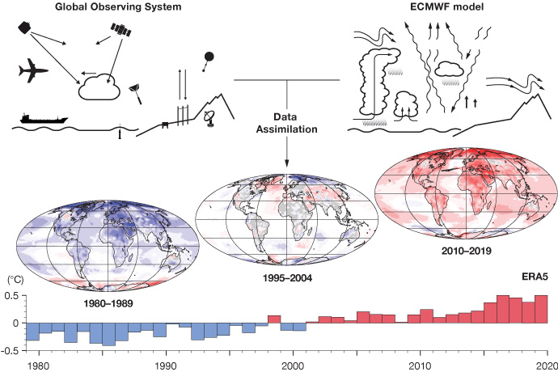
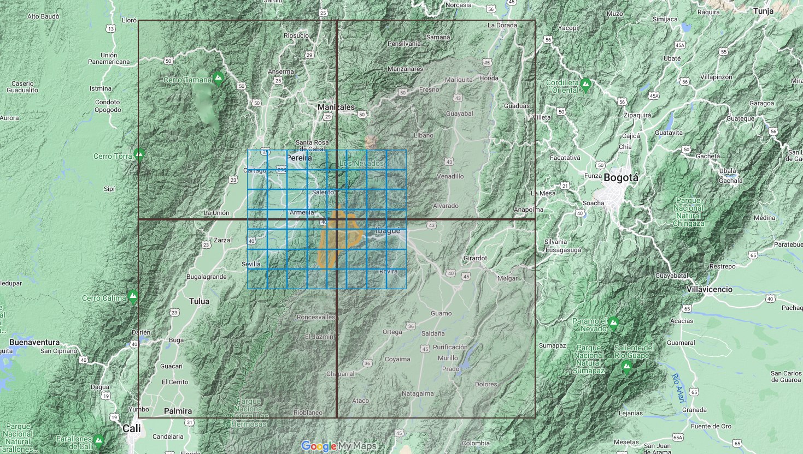
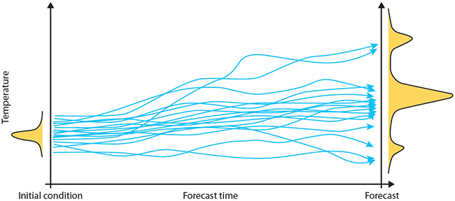

# Tutorial: clim4health_load 

</a>
</a>
</a>

<br>

## Overview and objectives

The second step in **clim4health** is to load the dowloaded data in the previous step (see `clim4health_get` tutorial) to start working with it. 


<br> 

The function `clim4health_load` allows the user to load different types of climate data (see [background information](#background-information)) in the form a local file in either *.csv* or *.nc* (NetCDF file) format. The data will be loaded in the R session as an *s2dv_cube* object (see [background information](#background-information)) which can be used in other **clim4health** functions. 

The objetives of this tutorial are as follows:

- To show how to load netCDF forecast, hindcast and reanalysis netCDF data into *s2dv_cube* objects.
- To learn how to visualize *s2dv_cube* objects.
- To show how to load reference station data from a .csv into *s2dv_cube* objects.


## Background information

### Climate data

This tutorial uses several different types of climate data:

- **Observations** of climate data are directly observed meteorological variables that come from a variety of sources, including satellites, radar, meteorological stations, aircraft, buoys, and more. Some of these formats are records of climate data in only one location. An example of observational data can be found [in the copernicus climate data store](https://cds.climate.copernicus.eu/datasets/insitu-observations-gruan-reference-network?tab=overview) and the diagram below illustrates a global system of observations.

{width=50%}

- **Reanalyses** are another form of "observed" climate data, and are what will be used in this tutorial. Reanalysis datasets are created by running a climate model that is combined with observational data. The benefit of reanalysis data is that it is a physically-consistent, temporally and spatially gridded dataset of past climate, which can be useful if direct observational coverage is sparse. It can also be useful because we can obtain estimates of variables that were not directly observed.

{width=45%}{width=45%}

- **Climate predictions** are model-based projections of *future* climate. Typically, climate projections are created using some initial condition (based on the current state of the weather/climate/ocean) and, if they are long term, can be forced by long-term projections of future greenhouse gases and aerosol concentrations. Climate predictions are often run with multiple **ensemble members**, which are the same experiment run multiple times starting from slightly different initial conditions. The figure below illustrates how multiple ensemble members can result in different predictions. 



There are different types of predictions:

- A **forecast** can predict weather on timescales of days/weeks and climate on scales of months/years. This tutorial will use seasonal forecasts, which predict climate for the upcoming months.
- A **hindcast**, which uses an initial condition from the past to generate a prediction of past climate.
    
### s2dv_cube object

clim4health_load loads climate data from a netCDF or csv file into R in the form of an *s2dv_cube*.

*s2dv_cube* is an object in the form of a multidimensional array, containing one or more variables in the dimensions of latitude, longitude and time, and the possibility of more dimensions (like ensemble member and/or leadtime). In addition to the array structure, the object includes attributes or information about its metadata, like the values of its coordinates or the name of the original files.


<br>
Now that we have all the background information, let's get started loading the data. To follow the tutorial, please clone the repository and change directory to the root of the repo.

## 1. Setup

First of all, let's check whether all the necessary dependencies are available and if not,
install them:

```R
if (!requireNamespace("startR", quietly = TRUE)) install.packages("pkgname")
if (!requireNamespace("lubridate", quietly = TRUE)) install.packages("pkgname")
if (!requireNamespace("easyNCDF", quietly = TRUE)) install.packages("pkgname")
if (!requireNamespace("CSTools", quietly = TRUE)) install.packages("pkgname")
```

Next, we source the *clim4health_load* function (make sure that the working directory is set to the path where the clim4health repository has been cloned).

```r
clim4health_path <- getwd()
source(paste0(clim4health_path, '/functions/clim4health_load.R'))
```

## 2. Load and visualize forecast data

To load forecast data in **clim4health**, the function `clim4health_load` is used. 
The function arguments include:

* `path`: string to the folder containing the files to be loaded.
* `var`: name of the variable to be extracted from the files. 
We work with "t2m", i.e. 2m temperature.
* `sdates`: list or vector of strings identifying which start dates to load.
* `data_type`: specify if the data is a forecast ("fcst") or observational dataset.
* `ext` = 'nc' or 'csv' specifies the file extension.

```r
# Path where the forecast data is found
fcst_path <- paste0(clim4health_path, '/sample_data/ecmwf51/forecast/')

# Load the forecast data
fcst <- clim4health_load(fcst_path, var = "t2m", data_type = "fcst",
                         sdates = "20240401", ext = 'nc')
```

We now check the new object with the forecast data.

```r
class(fcst)
#[1] "s2dv_cube"

dim(fcst$data)
#     dataset         var        year       month         day time_of_day 
#           1           1           1           3           1           1 
#    ensemble    latitude   longitude 
#          51          57          77

summary(fcst$data)
#   Min. 1st Qu.  Median    Mean 3rd Qu.    Max.
#  269.0   296.0   298.6   297.7   300.2   305.4

print(fcst$attrs$Variable$metadata$t2m$units)
#[1] "K"
```

The object *fcst* is an *s2dv_cube* with several dimensions.
*year*, *month*, *day* and *time_of_day* contain information on the dates in the file. *ensemble* is each of the ensemble members of forecast model.

Note that the data is in units of Kelvin. In case we want to transform to Celsius, we can transform the data and change the attributes of the *s2dv_cube* with the new units.
```r
fcst$data <- fcst$data - 273.15
fcst$attrs$Variable$metadata$t2m$units <- "C"
```

We can check the spatial and temporal coordinates of the *s2dv_cube*, which have been read from the original file. If the data is a forecast, we can find the lead times and start date of the forecast in the metadata.

```r
# Time stamps
print(fcst$attrs$Dates$metadata)
# [1] "2024-04-01 UTC" "2024-05-01 UTC" "2024-06-01 UTC"

# Start date and lead time dimensions
print(dim(fcst$attrs$Dates$metadata))
#    sdate lead_time
#        1         3

# Two ways of obtaining the starting date
print(fcst$attrs$Dates$metadata[ , 1])
# [1] "2024-04-01 UTC"
print(fcst$attrs$Dates$sdate)
# [1] "20240401"

# Year
fcst$coords$year
# [1] 2024

# Latitude
fcst$coords$latitude[1:length(fcst$coords$latitude)]
#  [1]  33  32  31  30  29  28  27  26  25  24  23  22  21  20  19  18  17  16  15
# [20]  14  13  12  11  10   9   8   7   6   5   4   3   2   1   0  -1  -2  -3  -4
# [39]  -5  -6  -7  -8  -9 -10 -11 -12 -13 -14 -15 -16 -17 -18 -19 -20 -21 -22 -23

# Longitude
fcst$coords$longitude[1:length(fcst$coords$longitude)]
#  [1] -93 -92 -91 -90 -89 -88 -87 -86 -85 -84 -83 -82 -81 -80 -79 -78 -77 -76 -75
# [20] -74 -73 -72 -71 -70 -69 -68 -67 -66 -65 -64 -63 -62 -61 -60 -59 -58 -57 -56
# [39] -55 -54 -53 -52 -51 -50 -49 -48 -47 -46 -45 -44 -43 -42 -41 -40 -39 -38 -37
# [58] -36 -35 -34 -33 -32 -31 -30 -29 -28 -27 -26 -25 -24 -23 -22 -21 -20 -19 -18
# [77] -17
```

Using the function `PlotEquiMap` from the *s2dv* package, we can plot the spatial array. First, we need to reduce the rest of dimensions; in this case we select the first time and do an ensemble mean.
```r
time_idx = 1
PlotEquiMap(var = MeanDims(drop(fcst$data)[time_idx,,,], 'ensemble'),
            lat = fcst$coords$latitude,
            lon = fcst$coords$longitude,
            filled.continents = FALSE,
            units = 'Temperature (C)', # legend title
            toptitle = paste0('Forecast ',
                              as.Date(fcst$attrs$Dates$Dates[time_idx]),
                              ' (ensemble mean)'), # Overall title
            fileout = paste0(clim4health_path, '/tutorials/figures/clim4health_load/fcst.png'))
```


## 3. Load hindcast data

We load the hindcast issued in the same month as the forecast (in this example April) for past years (in this case 2010, 2011 and 2012). We choose an example file within the folder as our hindcast path. We use the parameters `years` and `months` to specify the files to load.

```r
sdates <- c()
hcst_path <- c(paste0(clim4health_path, '/sample_data/ecmwf51/hindcast/'))
for (yy in c(2010, 2011, 2012)){
    sdates <- c(sdates, paste0(yy, '0401'))
}

hcst <- clim4health_load(hcst_path, var = "t2m", data_type = "hcst",
                         sdates = sdates, ext = 'nc')
```

Now, we check what has been loaded in the object *hcst* and transform to Celsius as before.

```r
class(hcst)
#[1] "s2dv_cube"

dim(hcst$data)
#    dataset         var        year       month         day time_of_day
#          1           1           3           3           1           1
#   ensemble    latitude   longitude
#         25          57          77

summary(hcst$data)
#   Min. 1st Qu.  Median    Mean 3rd Qu.    Max.
#  266.5   295.4   297.9   297.0   299.4   304.7

hcst$data <- hcst$data - 273.15
hcst$attrs$Variable$metadata$t2m$units <- "C"

```
Check the temporal coordinates of the hcst *s2dv_cube*.

```r
# Time stamps
print(hcst$attrs$Dates$metadata)
# [1] "2010-04-01 UTC" "2011-04-01 UTC" "2012-04-01 UTC" "2010-05-01 UTC"
# [5] "2011-05-01 UTC" "2012-05-01 UTC" "2010-06-01 UTC" "2011-06-01 UTC"
# [9] "2012-06-01 UTC"

# Start date and lead time dimensions
print(dim(hcst$attrs$Dates$metadata)) 
#     sdate lead_time 
#         3         3

# hindcast start dates 
print(hcst$attrs$Dates$metadata[ , 1])
# [1] "2010-04-01 UTC" "2011-04-01 UTC" "2012-04-01 UTC"
```
As we have loaded 3 start dates, each with 3 lead times, there are now 3x3 dates in the file.

## 4. Load reference data

### From a netCDF file

We would now like to load an observational (reference) dataset from a netCDF file,
e.g. a reanalysis dataset. To load the same dates as in the hindcast, we extract 
the dates using the ```hcst$coords$time``` object as above. We can also subset 
by latitude and longitude using `lat_selection` and `lon_selection` arguments.

```r
# extract lat/lon range from hcst object
latitudes <- hcst$coords$latitude
longitudes <- hcst$coords$longitude
lats <- c(min(latitudes), max(latitudes))
lons <- c(min(longitudes), max(longitudes))

# extract dates from hcst object. We need to transpose the dates so that 
# they are correctly ordered.
dates <- as.Date(hcst$attrs$Dates$Dates)
dates <- t(drop(dates)[,c(1,2)])
dim(dates) <- NULL
sdates <- format(dates, "%Y%m")

print(sdates)
# [1] "201004" "201005" "201006" "201104" "201105" "201106"

obs_path <- paste0(clim4health_path, '/sample_data/era5land/')
obs <- clim4health_load(obs_path, var = "t2m",
                        sdates = sdates, data_type = "obs",
                        lat_selection = lats, lon_selection = lons)

```
Now we check what has been loaded in the object *obs*.

```r
class(obs)
#[1] "s2dv_cube"

dim(obs$data)
#  dataset         var        year       month         day time_of_day 
#        1           1           3           2           1           1 
# ensemble    latitude   longitude 
#        1         561         761 

summary(obs$data)
#   Min. 1st Qu.  Median    Mean 3rd Qu.    Max.    NA's 
#  265.9   296.2   297.9   296.5   298.8   305.6 1824240

obs$data <- obs$data - 273.15
obs$attrs$Variable$metadata$t2m$units <- "C"

obs$attrs$Dates$Dates
# [1] "2010-04-01" "2010-05-01" "2011-04-01" "2011-05-01" "2012-04-01"
# [6] "2012-05-01"

obs$attrs$Dates$metadata
# NULL
```

Our forecast, hindcast, and observational datasets have now all been loaded in the same format.


### From a csv file

We can also load observational data, e.g. from weather stations, in csv format. For example, try:

```r
point_locs <- clim4health_load(paste0(clim4health_path,
                                      "/sample_data/point_locations/weather_stations"),
                               data_type = "obs", ext = "csv")

dim(point_locs$data)
#     dataset         var        year       month         day time_of_day 
#          1           1           2          12          31           1 
#   ensemble    latitude   longitude 
#          1           2           2

summary(point_locs$data)
#   Min. 1st Qu.  Median    Mean 3rd Qu.    Max.    NA's 
#  20.00   21.30   22.50   22.51   23.80   25.00    1514 
```