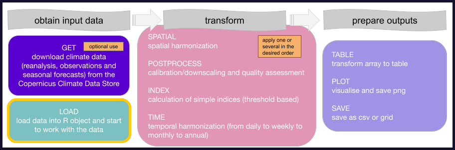
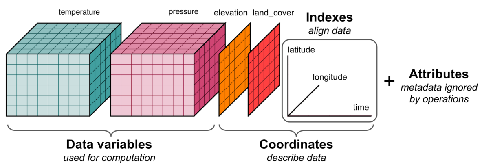
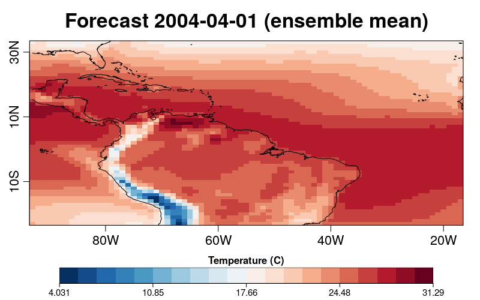

</a>
</a>

&nbsp

# Tutorial to use clim4health_load function </a>

*clim4health_load* allows to load data from a local file in the *.csv* or *.nc* (netcdf file) formats. The data will be loaded in the R session as a *s2dv_cube* object which can be input in other *clim4health* functions.


*s2dv_cube* is an object in the form of a multidimensional array, containing one or several variables in the dimensions of latitude, longitude and time, and the possibility of more dimensions (like ensemble member and/or leadtime). In addition to the array structure, the object includes attributes or information about its metadata, like the values of its coordinates or the name of the original files.


## Objectives of this tutorial
- To show how to load a forecast with its corresponding hindcast and reference reanalysis in a format that allows for the application of other **clim4health** functions
- To show how to load data from a .csv in a format that allows for the application of other clim4health functions (e.g. *clim4health_postprocess* to obtain downscaled forecasts to point locations)

### Working directory and library dependencies
Obtain current path, which need to be the path where the clim4health repository is cloned, and source the *clim4health_load* function

```r
clim4health_path <- getwd()
source(paste0(clim4health_path, '/functions/clim4health_load.R'))        
```

At the moment the function is loaded, the dependencies will also be loaded, if some error ocurres, make sure that all the necessary dependencies are installed:

```
install.packages("startR")
library(startR)

install.packages("lubridate")
library(lubridate)

install.packages("easyNCDF")
library(easyNCDF)

install.packages("CSTools")
library(CSTools)
```

### Climate data

- Observations
- Reanalysis
- Climate predictions

(to be further explained)

### Load forecast
Load forecast data from sample data in **clim4health**, it is possible to select a different path to load a forecast from a different file

```r
fcst <- clim4health_load(paste0(clim4health_path, '/sample_data/ecmwf51/forecast/t2m_20240401.nc'))        
```

### Check loaded forecast
Check what has been loaded in the object *fcst*

```r
class(fcst)
#[1] "s2dv_cube"

dim(fcst$data)
#  dataset       var      time  ensemble  latitude longitude
#        1         1         3        51        57        77

summary(fcst$data)
#   Min. 1st Qu.  Median    Mean 3rd Qu.    Max.
#  269.0   296.0   298.6   297.7   300.2   305.4
```

The data is in K, in case we want to transform to degree C, we can do it now:
```r
fcst$data <- fcst$data - 273.15
```


The object *fcst* is an *s2dv_cube* with the above dimensions in **data**, *time* is the leadtime in the netcdf file, *ensemble* is each of the ensemble members of forecast model.

We can check the spatial and temporal coordinates of the *s2dv_cube*, which are read from the netcdf file when the data is loaded:

```r
fcst$coords$time
# [1] "2024-04-01" "2024-05-01" "2024-06-01"

fcst$coords$latitude[1:length(fcst$coords$latitude)]
# [1]  33  32  31  30  29  28  27  26  25  24  23  22  21  20  19  18  17  16  15
# [20]  14  13  12  11  10   9   8   7   6   5   4   3   2   1   0  -1  -2  -3  -4
# [39]  -5  -6  -7  -8  -9 -10 -11 -12 -13 -14 -15 -16 -17 -18 -19 -20 -21 -22 -23
# simply fcst$coords$latitude will show more information
# on the latitude in addition to the values

fcst$coords$longitude[1:length(fcst$coords$longitude)]
# [1] -93 -92 -91 -90 -89 -88 -87 -86 -85 -84 -83 -82 -81 -80 -79 -78 -77 -76 -75
# [20] -74 -73 -72 -71 -70 -69 -68 -67 -66 -65 -64 -63 -62 -61 -60 -59 -58 -57 -56
# [39] -55 -54 -53 -52 -51 -50 -49 -48 -47 -46 -45 -44 -43 -42 -41 -40 -39 -38 -37
# [58] -36 -35 -34 -33 -32 -31 -30 -29 -28 -27 -26 -25 -24 -23 -22 -21 -20 -19 -18
# [77] -17
```

### Visualize loaded forecast

Using the function *PlotEquiMap* from the *s2dv* package, we can plot the spatial array, however, we need to reduce the rest of dimensions; in this case we select the first time and do an ensemble mean.
```r
PlotEquiMap(var = MeanDims(fcst$data[1,1,1,,,], 'ensemble'),
            lat = fcst$coords$latitude,
            lon = fcst$coords$longitude,
            filled.continents = FALSE,
            units = 'Temperature (C)', # text to appear in the legend
            toptitle = 'Forecast 2004-04-01 (ensemble mean)', # text to appear as overall title
            fileout = paste0(clim4health_path, '/tutorials/figures/clim4health_load/fcst.png')
            )
```


### Load hindcast and reference
Load hindcast (past forecast) and reference dataset (from netcdf or csv) from sample data in **clim4health**

#### Load hindcast
In this case we want to load the hindcast issued in the same month as the forecast (in this example April) but for each of the year in the past (in this case 2010, 2011 and 2012)

```r
for (yy in c(2010, 2011, 2012)){
    hcst <- clim4health_load(paste0(clim4health_path, '/sample_data/ecmwf51/hindcast/t2m_', yy, '0401.nc'))        
}
```

#### Load reference
##### from *.nc*
##### from *.csv*
##### harmonize reference with hindcast
