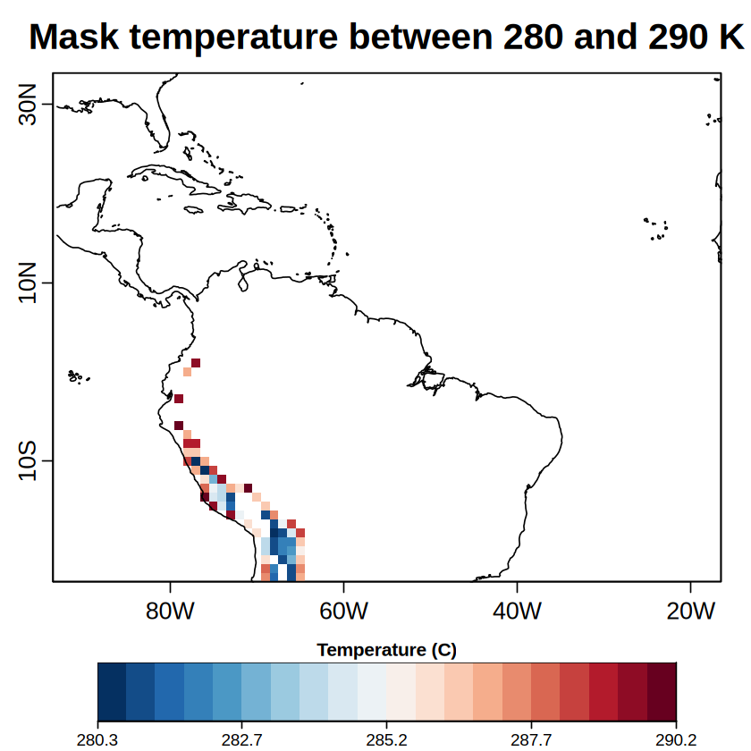
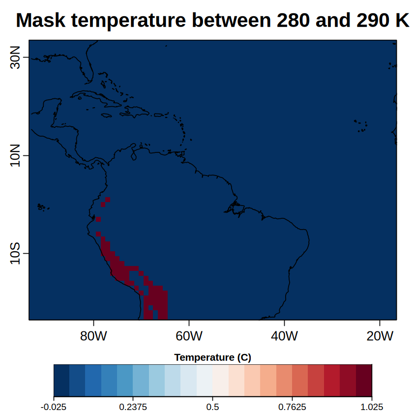

# Tutorial for clim4health_index

----------------------------------------------------------------------------------------------------
## 1. Load the functions from clim4health


```R
source('./functions/clim4health_load.R')
source('./functions/clim4health_index.R')
```

-------------------------------------------------------------------------------
## 2. Load the dataset with the function clim4health_load


```R
data <- clim4health_load('./sample_data/ecmwf51/forecast/t2m_20240401.nc')
```

-----------------------------------------------------------------------------
## 3. Create a mask with clim4health_index function
- With values 0 and 1
- With original values and NaNs

### 3.1 With original values and NaNs
- The values included in the thresholds mantain the origial value the ones wich not are set as NaNs


```R
mask <- clim4health_index(data, mod_vals = TRUE,  lower_threshold = 280, upper_threshold = 290, lower_close = FALSE, upper_close = FALSE)

PlotEquiMap(var = mask$data[1, 1, 1, 1, , ],
            lat = mask$coords$latitude,
            lon = mask$coords$longitude,
            filled.continents = FALSE,
            units = 'Temperature (C)', # text to appear in the legend
            toptitle = 'Mask temperature between 280 and 290 K', # text to appear as overall title
            colNA = '#ffffff'
            )
```


    

    


### 3.2 With original values and NaNs
- The values included in the thresholds are set as 1 the rest of it as 0


```R
mask <- clim4health_index(data, mod_vals = FALSE,  lower_threshold = 280, upper_threshold = 290, lower_close = FALSE, upper_close = FALSE)

PlotEquiMap(var = mask$data[1, 1, 1, 1, , ],
            lat = mask$coords$latitude,
            lon = mask$coords$longitude,
            filled.continents = FALSE,
            units = 'Temperature (C)', # text to appear in the legend
            toptitle = 'Mask temperature between 280 and 290 K', # text to appear as overall title
            colNA = '#ffffff'
            )
```


    

    

